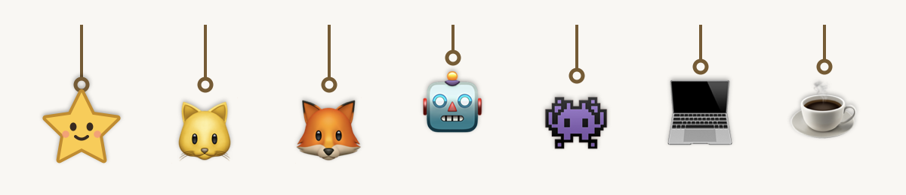
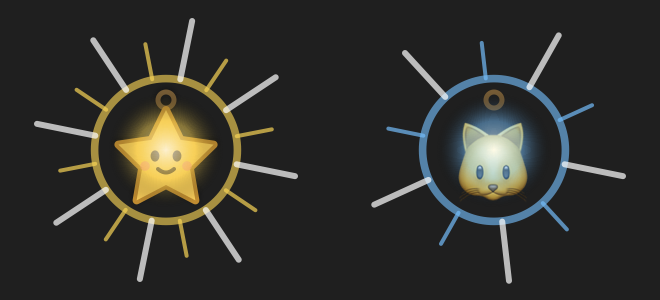
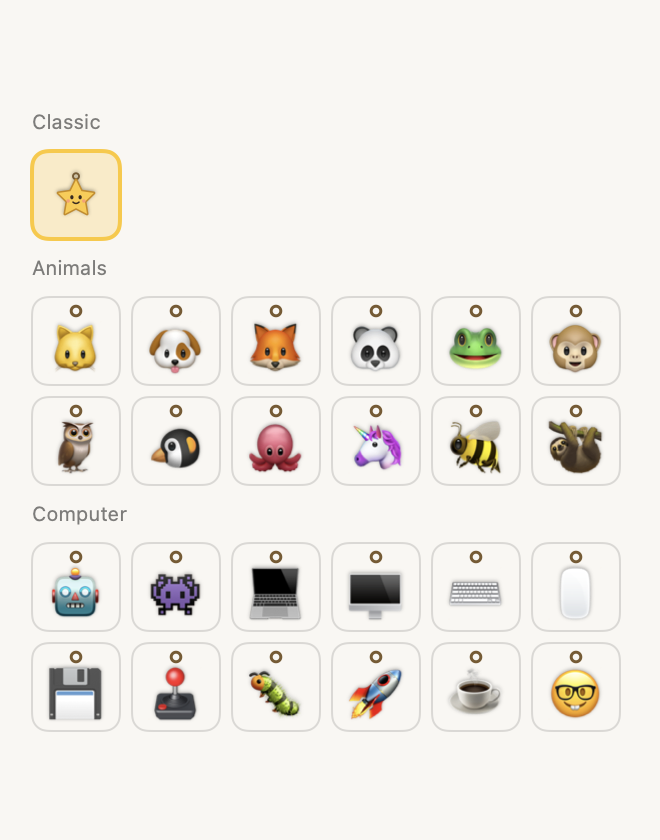

# Tuglet

A little Mac app for personal reminders. **Pip**, a friendly star on a string (or a cat, fox, robot, laptop… your pick), hangs from the top of your screen above every app, and drops, swings and shakes when something is due.

- **Pull Pip a little** and let go: **snooze** (5 minutes by default).
- **Pull Pip all the way down** (the rope fights back, and Pip trembles when you're there) and let go: **complete**, with an anime-style flash. Undo is available for 10 seconds.
- Prefer clicking? **Snooze** and **Complete** buttons sit right under Pip and in the menu bar.

Reminders stay on your Mac. No account, no internet connection, no tracking.

> 🚧 **Early version (0.3.0).** This is an early iteration of the Mac app, now with 25 characters. More updates are coming soon: editing, repeating reminders, custom-drawn characters, and optional Slack/GitHub notifications. Feedback is very welcome.

| Reminder due | Pulling to complete | Pick a character |
| --- | --- | --- |
|  |  |  |

*Images are rendered from the app's real views with made-up reminders.*

## Get it

**→ [Download and install guide for teammates](docs/INSTALL.md)**. It covers the download, the one-time **Open Anyway** step, and how to use Pip.

Quick version: download **`Tuglet-x.y.z-mac.zip`** from **[Releases](https://github.com/Ajitsanto09/tuglet/releases/latest)** (not the green Code button), move Tuglet to Applications, open it, and approve it once in **System Settings → Privacy & Security → Open Anyway**. Double-click Tuglet any time to open its window. Needs macOS 13 or newer, on Apple silicon or Intel.

Why the extra step? The app is signed for free instead of through Apple's paid developer program, so macOS asks you to approve it once. Details are in the [install guide](docs/INSTALL.md#3-the-one-time-open-anyway-step-why-its-needed).

## Where it came from

Tuglet began as a Chrome extension (v0.1.0). That version is **retired**: Pip could only appear inside web pages. The Mac app shows Pip over everything. The extension's code remains in git history at tag `v0.1.0`.

## Project documents

[Install and use](docs/INSTALL.md) · [Development](docs/DEVELOPMENT.md) · [Publishing a release](docs/PUBLISHING.md) · [Privacy](docs/PRIVACY.md) · [Acceptance checks](docs/ACCEPTANCE.md) · [Roadmap](docs/ROADMAP.md) · [Security](SECURITY.md) · [Contributing](CONTRIBUTING.md) · [Changelog](CHANGELOG.md)

## License

MIT. Pip is original artwork released under the same license. The other characters are drawn by macOS's built-in Apple Color Emoji font on your Mac; no emoji images are included in this project.
