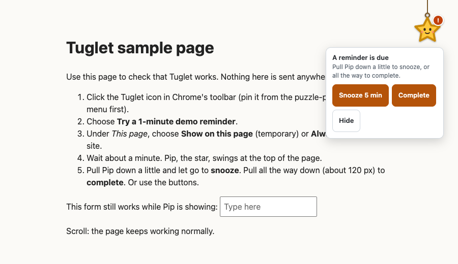
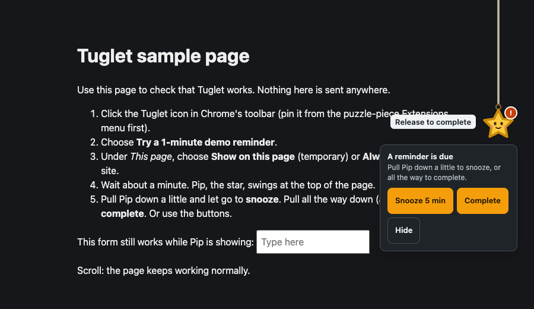

# Tuglet

Personal reminders for Chrome, with a small friendly star called **Pip** hanging from the top of the web pages you choose.

- **Pull Pip a little** (24–119 px) and let go: **snooze** (5 minutes by default).
- **Pull Pip all the way** (120 px or more) and let go: **complete**. Undo is available for 10 seconds.
- Prefer not to drag? **Snooze** and **Complete** buttons sit right next to Pip, and everything works by keyboard.

Reminders stay on your computer. No account, no server, no analytics, no network requests.

| Reminder due (light) | Pulling to complete (dark) |
| --- | --- |
|  |  |

Screenshots are of the real extension with synthetic data, captured by `tests/e2e/screenshots.spec.ts`.

> Tuglet is a working name. Status: **0.1.0 local pilot.** Not yet on the Chrome Web Store.

## Install

- **Teammates (no coding):** follow [docs/LOCAL-INSTALL.md](docs/LOCAL-INSTALL.md). You need the release file `tuglet-0.1.0.zip` and Chrome 120 or newer.
- **Developers:** see [docs/DEVELOPMENT.md](docs/DEVELOPMENT.md).

Tested with Chromium 156.0.8078.4 (automated suite) and Google Chrome 157.0.8103.38 on macOS 15.7 (smoke test). See [docs/ACCEPTANCE.md](docs/ACCEPTANCE.md).

## How it works

1. Click the Tuglet toolbar icon and add a reminder (or try the 1-minute demo).
2. On a normal website, choose **Show on this page** (temporary) or **Always allow on this site**. You can skip this: the toolbar list and badge always work.
3. When a reminder is due, Pip swings for a few seconds, then waits with a small "!" marker until you act.

Pip appears inside the web page, just below Chrome's toolbar. Chrome does not let extensions draw over the address bar or tabs, and Pip cannot appear on `chrome://` pages, the Chrome Web Store, PDFs or local files; use the toolbar popup there.

## Permissions at a glance

| Permission | Why |
| --- | --- |
| `storage` | Save your reminders and settings on this device. |
| `alarms` | Wake Tuglet when a reminder is due. |
| `scripting` + `activeTab` | Draw Pip on a page, only after you click a Tuglet button. |
| Site access (optional, one site at a time) | Show Pip automatically on a site you chose "Always allow" for. |
| `notifications` (optional) | Silent system notifications, only if you turn them on. |

Details: [docs/PERMISSIONS.md](docs/PERMISSIONS.md) · Privacy: [docs/PRIVACY.md](docs/PRIVACY.md)

## Integrations

Slack, GitHub review notifications, extra characters and AI features are **not** in this version and the extension requests no access for them. See [docs/ROADMAP.md](docs/ROADMAP.md).

## Project documents

[Local install](docs/LOCAL-INSTALL.md) · [Development](docs/DEVELOPMENT.md) · [Publishing](docs/PUBLISHING.md) · [Store listing draft](docs/STORE-LISTING.md) · [Acceptance](docs/ACCEPTANCE.md) · [Roadmap](docs/ROADMAP.md) · [Security](SECURITY.md) · [Contributing](CONTRIBUTING.md) · [Changelog](CHANGELOG.md)

## License

MIT. Pip is original artwork released under the same license. Bundled React is MIT licensed; see `THIRD_PARTY_NOTICES.txt` in the package.
