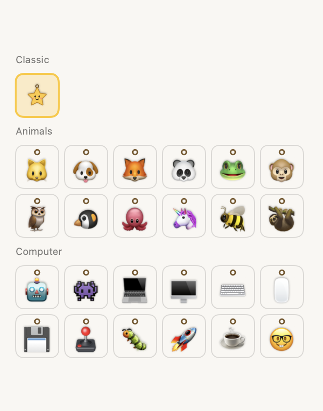

# Install and use Tuglet on your Mac

> **This is an early version of Tuglet (0.3.0).** It does the basics, reminders, snooze and complete, and now lets you pick your character. More updates are coming soon. Ideas and problems are very welcome; see "Tell us what you think" at the end.

You don't need to know how to code. This takes about 5 minutes.

**You need:** a Mac running **macOS 13 Ventura or newer** (Apple menu  → About This Mac). Both Apple silicon (M1/M2/M3/M4) and Intel Macs work.

---

## 1. Download

1. Open **https://github.com/Ajitsanto09/tuglet/releases/latest**. The repository is private, so sign in to GitHub with an account that has access. If you get a "404" page, ask the maintainer to add you.
2. Under **Assets**, click the file named **`Tuglet-<version>-mac.zip`** (for example `Tuglet-0.3.0-mac.zip`).

   ⚠️ Don't use "Source code (zip)" or the green **Code → Download ZIP** button. Those are the project's code, not the app.

3. Your Mac usually unzips it for you. In **Downloads** you should now see **Tuglet** (an app with a star icon). If you only see the `.zip`, double-click it.

*Optional, for the careful:* check the download wasn't damaged. Open **Terminal** and run `shasum -a 256 ~/Downloads/Tuglet-0.3.0-mac.zip` (use the version you downloaded). The result should match the line in the release's `SHA256SUMS` file.

## 2. Move it to Applications

Drag **Tuglet** from Downloads into your **Applications** folder (in Finder's sidebar). Keep it there: "open at login" works best from Applications.

## 3. The one-time "Open Anyway" step (why it's needed)

Apple shows a warning for apps that weren't registered with Apple through its paid developer program. Tuglet is a free internal tool, so it isn't registered. **The app is still signed, and it doesn't connect to the internet.** You approve it once and then it opens normally.

### On macOS 15 Sequoia or newer

1. Double-click **Tuglet** in Applications.
2. A message says something like **"Tuglet" Not Opened: Apple could not verify "Tuglet" is free of malware…** Click **Done**. Don't click "Move to Bin".
3. Open **System Settings** ( menu → System Settings…) → **Privacy & Security**.
4. Scroll down to the **Security** section. You'll see **"Tuglet" was blocked to protect your Mac.** Click **Open Anyway**.
   (The button only appears for about an hour after step 2. If it's missing, repeat step 1.)
5. Click **Open Anyway** again in the pop-up and enter your Mac password (or use Touch ID).
6. Tuglet opens and shows its window. From now on it opens normally, with no more warnings.

### On macOS 13 Ventura or 14 Sonoma

1. In Applications, **right-click** (or Control-click) **Tuglet** and choose **Open**.
2. In the warning, click **Open**.

If that warning has no Open button, use the System Settings → Privacy & Security → **Open Anyway** steps above.

**Please don't** turn off your Mac's security features, or run Terminal commands from the internet to skip this. "Open Anyway" approves only Tuglet and leaves your Mac's protection on. If your company manages your Mac and blocks the app, ask IT. Some company Macs don't allow unregistered apps at all.

## 4. Find Tuglet

The first time Tuglet opens, its **Tuglet window** appears with a short welcome from Pip. That's where you add reminders.

After that, Tuglet works quietly in the background:

- **In the menu bar** at the top right of your screen, as a small **☆ star** (**★ 2** means 2 reminders are due). Click it to open the same reminder list.
- **Double-click Tuglet in Applications any time** to bring the Tuglet window back, even while it's running.
- **Click Pip** when nothing is due to open the window too.

Tuglet has no Dock icon. Closing the window doesn't quit it.

**Can't see the ☆?** On MacBooks with a camera notch, a full menu bar can hide icons behind the notch. Tuglet still works. Double-click it in Applications instead, or make room by quitting other menu bar apps (or hold ⌘ and drag other icons off the menu bar).

**Turn on "Open Tuglet when I log in"** (Tuglet menu → Settings) so your reminders work after every restart. Tuglet can only remind you while it's running.

---

## Using Tuglet

### Add a reminder

1. Open the **Tuglet window** (double-click Tuglet in Applications) or click the **☆** in the menu bar.
2. Type what you want to remember, for example *"Check the release smoke test"*.
3. Pick a time, or click a shortcut: **In 5 min**, **In 15 min**, **In 30 min**, **In 60 min**.
4. Click **Add reminder**, or press Return.

To try it out, click **Try a 1-minute demo**.

### Meet Pip

As soon as you have a reminder, **Pip**, a little star on a string, hangs from the **top of your screen**, just under the menu bar. Pip floats above every app (browser, Slack, Figma, your editor, even full-screen apps) and stays out of the way until something is due.

When a reminder is **due**:

- Pip **drops** on its rope, bounces back and **swings hard** for a couple of seconds to catch your eye.
- Until you snooze or complete it, Pip gives a **little shake every 45 seconds**, so it's hard to miss.
- A small **number** on Pip shows how many reminders are due.
- A card under Pip shows the reminder and buttons.

### Pick your character

Don't fancy a star? Open the Tuglet window (or ☆ menu) → **Character**, and click one:

- **Classic:** Pip the star
- **Animals:** cat, dog, fox, panda, frog, monkey, owl, penguin, octopus, unicorn, bee, sloth
- **Computer:** robot, space invader, laptop, desktop, keyboard, mouse, floppy disk, joystick, bug, rocket, coffee, nerd face

The change is instant. Everything works the same whichever character you pick; this guide calls it "Pip".

### Snooze or complete: pull Pip

| Do this | What happens |
| --- | --- |
| Pull Pip **down a little** (about a finger's width) and let go | **Snooze.** Pip asks again in 5 minutes (you can change this). |
| Pull Pip **all the way down** (about twice Pip's height) and let go | **Complete.** The reminder is done. |
| Pull, change your mind, move back up near the top, let go | **Nothing happens.** |

While you pull, a label next to Pip says **"Let go to snooze"** or **"Let go to complete"**, so you always know what will happen before you let go.

### Or just click

Prefer not to drag? Use the buttons on the card under Pip, or in the Tuglet menu:

- **Snooze 5 min**
- **Complete**
- **Hide** folds the card away. It does *not* complete the reminder. Click Pip to bring the card back.

### Oops, I completed it by mistake

Click **Undo** within **10 seconds**, either on the card under Pip or at the top of the Tuglet menu. The reminder comes back as due.

### Several reminders due

Pip shows them one at a time, oldest first ("1 of 3 due"). Complete or snooze one and the next appears.

### Change or remove a reminder

Open the Tuglet window or menu. Under **Coming up**, click **Delete**, then **Confirm delete**. To change a time, delete it and add it again. (Editing is planned for a future update.)

### Settings (in the Tuglet window or menu)

- **Snooze for:** 5, 10, 15 or 30 minutes.
- **Pip hangs on the:** right or left side of the screen.
- **Show the reminder text on Pip:** turn this off before sharing your screen in meetings. Pip then only says "A reminder is due".
- **Keep the character still:** no dropping, swinging or shaking (Pip still shows the due number and card). Tuglet also follows your Mac's *Reduce motion* setting (System Settings → Accessibility → Display).
- **Open Tuglet when I log in.**

### When Pip goes away

When you have no reminders left, Pip disappears. It comes back when you add one.

---

## Good to know

- **Your reminders stay on your Mac.** No account, no internet connection, no tracking. See [PRIVACY.md](PRIVACY.md).
- **Tuglet must be running** to remind you. If your Mac was asleep or Tuglet was closed when a reminder was due, Pip shows it as due as soon as Tuglet is running again.
- **Several screens:** Pip hangs on your main screen (the one with the menu bar in Displays settings).
- **Quit:** Tuglet menu → **Quit Tuglet**. Open it again from Applications.

## Updating to a new version

1. Quit Tuglet (Tuglet menu → Quit Tuglet).
2. Download the new `Tuglet-x.y.z-mac.zip` from the [Releases page](https://github.com/Ajitsanto09/tuglet/releases/latest).
3. Drag the new **Tuglet** into Applications and choose **Replace**.
4. Open it. You may need to do the one-time **Open Anyway** step again for the new version.

Your reminders are kept. They're stored separately from the app.

## Removing Tuglet

1. Tuglet menu → Settings → turn off **Open Tuglet when I log in**, then **Quit Tuglet**.
2. Drag **Tuglet** from Applications to the Bin.
3. Optional, to also delete your reminders: in Finder choose **Go → Go to Folder…**, type `~/Library/Application Support/Tuglet`, and delete that folder.

## Troubleshooting

| Problem | What to do |
| --- | --- |
| "Tuglet" Not Opened / can't be opened | Do the **Open Anyway** step (section 3). |
| No **Open Anyway** button in Privacy & Security | Double-click Tuglet again first; the button appears for about an hour afterwards. |
| "Tuglet is damaged and can't be opened" | The download was probably corrupted. Delete it, download again, and check the checksum. |
| I downloaded a folder called `tuglet-main` | That's the source code. Download **`Tuglet-<version>-mac.zip`** from the Releases page instead. |
| I double-click Tuglet and nothing seems to happen | Update to 0.2.1 or newer: it opens the Tuglet window. In 0.2.0, Tuglet was running but only in the menu bar, often hidden behind the notch. |
| I can't see the ☆ in the menu bar | It's probably hidden behind the camera notch. Double-click Tuglet in Applications to open its window, or quit other menu bar apps to make room. |
| Pip doesn't appear | Pip only shows when you have reminders. Add one, or try the 1-minute demo. |
| Reminder came late | Your Mac was asleep or Tuglet wasn't running. Turn on "Open Tuglet when I log in". |
| Pip is in the way | Click **Hide**, move Pip to the left side in Settings, or snooze. |
| The shaking is too much | Settings → **Keep the character still**, or snooze the reminder. |
| "Couldn't save…" message | Nothing was changed. Try again. If it keeps happening, check your disk isn't full. |
| "Saved by a newer Tuglet" message | You opened an older version after a newer one. Download the latest release. |

## Tell us what you think

This is the **first iteration**, and it will improve with your feedback. Planned next: editing reminders, repeating reminders, custom-drawn characters, and optional Slack and GitHub notifications (see [ROADMAP.md](ROADMAP.md)).

Report problems or ideas as an issue in the GitHub repository (**Issues → New issue**). Use made-up reminder text in screenshots, never real work details.
